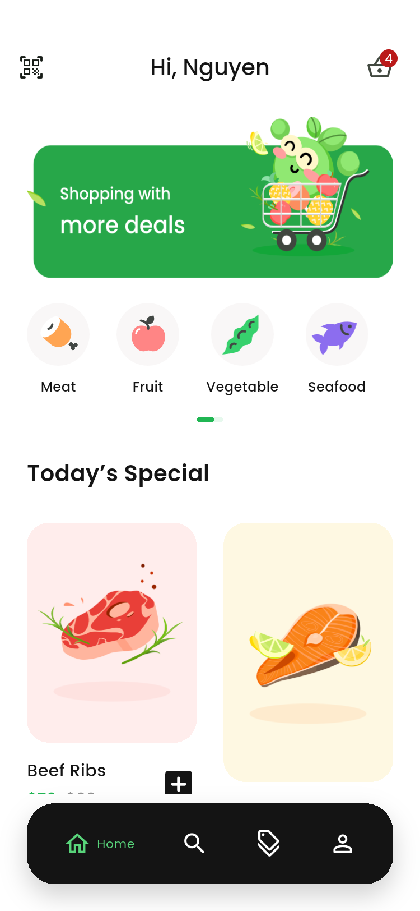
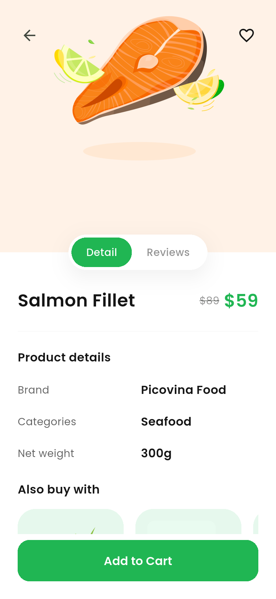
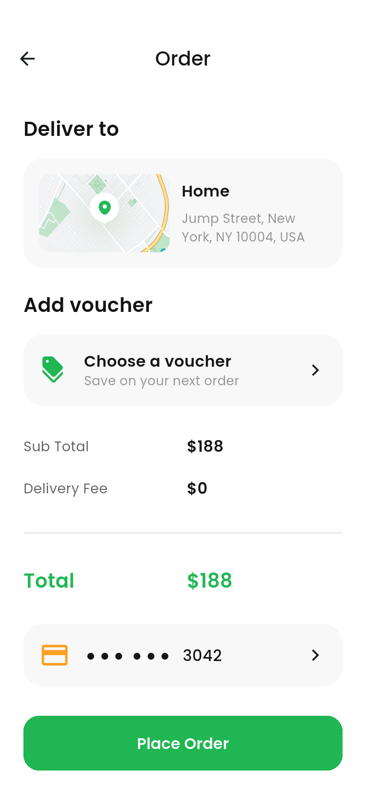
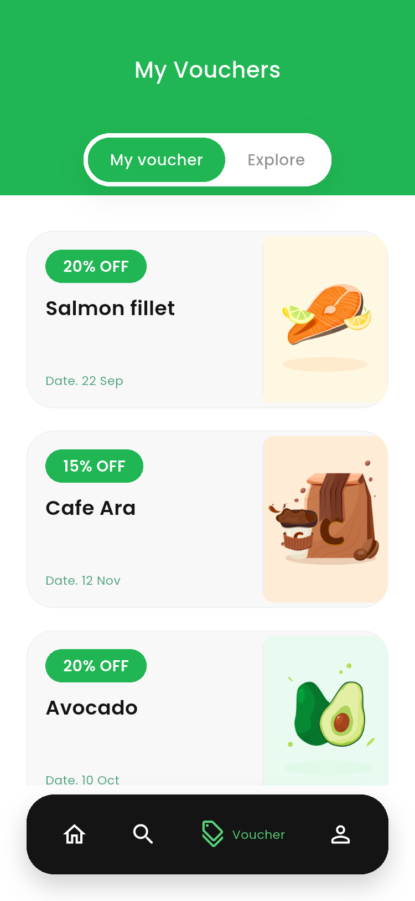
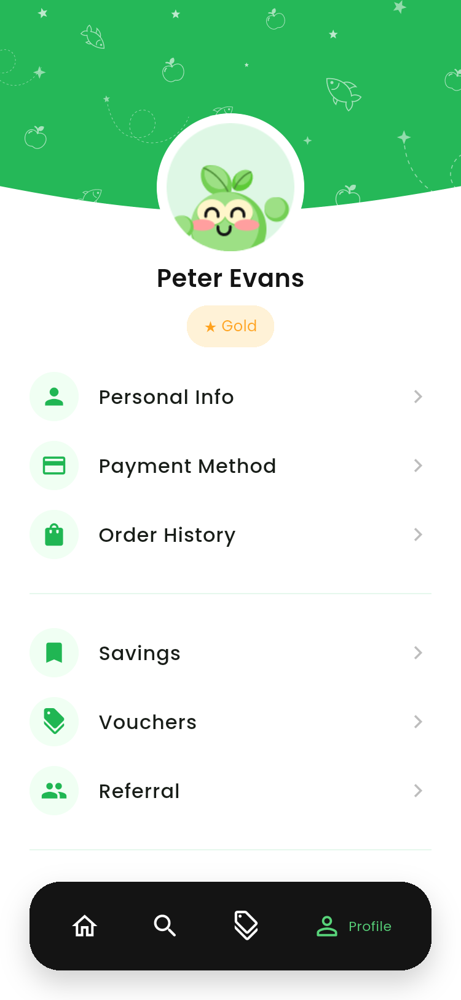
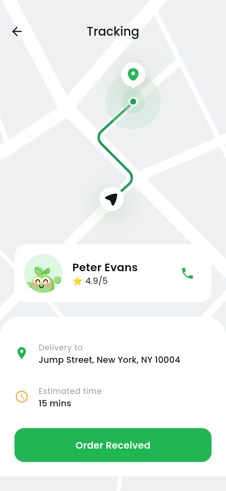
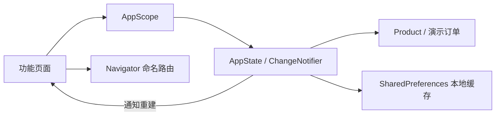

# Ecobi Flutter 项目说明

依据 Pixso 中 **Ecobi - Food & Delivery UI Kit / Pit Studio** 实现的生鲜配送 Flutter 应用。已读取「🍋 UI Design File」的 16 个分类、49 个画板，并核对 Foundations 中的字体、颜色和插画。英文文案沿用设计稿。

这是可以本地运行、操作和保存状态的 UI 演示项目。登录、支付、物流、相机及第三方账户使用演示流程，未接入生产服务。

## 界面预览

以下图片来自 Android 模拟器运行的 Flutter 界面；Pixso 原稿另存于 `docs/reference/`。

| 首页 | 商品详情 | 结算 |
| --- | --- | --- |
|  |  |  |

| 优惠券 | 个人中心 | 订单追踪 |
| --- | --- | --- |
|  |  |  |

## 功能和操作入口

- 首次启动进入三步引导，随后是欢迎页和注册/登录；演示手机号可填 969266825，OTP 填 **1234**，密码至少 8 位并含字母及数字。
- 首页分类可进入商品搜索；加号加入购物车，商品详情支持收藏及评价页面切换。
- 购物车支持数量增减、左滑删除、删除确认、空购物车。结算页可选地址、优惠券和演示支付方式，下单后清空购物车并生成订单记录。
- Explore 支持商品名称、分类检索及价格范围筛选；其他筛选开关保留界面状态，未连接真实商家/城市服务。
- 个人中心包含资料编辑、支付卡片、历史订单、收藏商店/商品、优惠券和推荐码。卡片仅持久保存末四位；不会保存完整卡号或 CVV。
- 演示扫码使用原稿中的两种预览背景；不会调用真实相机。追踪页为静态地图演示。
- **Profile → About Ecobi → Browse all screens** 可逐页查看所有界面和特殊状态。

## 项目结构与架构

```text
EcobiFoodDelivery/
├── lib/
│   ├── main.dart                  # 初始化和本地状态恢复
│   ├── app.dart                   # 应用、路由表、全页面预览入口
│   ├── core/theme.dart            # 颜色、Poppins 字体、按钮和输入框主题
│   ├── data/app_state.dart        # 商品模型、演示数据、共享状态、本地保存
│   ├── widgets/common.dart        # 页面容器、按钮、Tab、分段控件等
│   └── features/
│       ├── auth.dart              # 启动、引导、登录和注册
│       ├── catalog.dart           # 首页、搜索筛选、商品评价、扫码预览
│       ├── checkout.dart          # 购物车、结算、选项、订单成功和追踪
│       ├── profile.dart           # 资料、卡片、历史、收藏和推荐
│       └── vouchers.dart          # 优惠券列表和详情
├── assets/
│   ├── images/                    # 从 Pixso 导出的插画和背景
│   └── fonts/                     # Poppins 字体及 OFL 授权
├── test/widget_test.dart           # 业务计算、持久化、校验、布局和下单测试
├── integration_test/              # Android 实机运行截图测试
├── test_driver/                   # 模拟器测试驱动
├── tool/capture_screenshots.ps1    # 截图和导出脚本
├── docs/
│   ├── ARCHITECTURE.md            # 架构、状态和扩展说明
│   ├── PAGE_CATALOG.md            # 49 个原稿画板和实现/截图对应表
│   ├── SCREENSHOTS.md             # 全部实际运行截图索引
│   ├── TEST_REPORT.md             # 验证记录和已知边界
│   ├── design-inventory.json      # Pixso 节点、分类、尺寸和文本记录
│   ├── reference/                 # 49 张 Pixso 原稿导出图
│   └── screenshots/               # Flutter 实际运行截图
├── android/                       # Android 宿主
├── ios/                           # iOS 宿主（需要 macOS 构建）
├── web/                           # Web 宿主
├── pubspec.yaml
└── pubspec.lock
```

采用 **按功能组织页面 + ChangeNotifier 共享状态 + SharedPreferences 本地存储**。页面通过 `AppScope` 访问状态，调用状态方法更新数据，依赖的页面自动重建。使用 Flutter 内置 Navigator 命名路由，不额外引入路由或状态管理框架。键盘、焦点、滚动、弹窗使用 Flutter/系统组件；相同页面的输入、空白和删除等状态由参数复用实现。



更详细的职责划分、数据约束和接入后端的建议见 [架构说明](docs/ARCHITECTURE.md)。

## 运行

开发验证环境：Flutter **3.47.7** / Dart **3.13.5**，Android 15 / API 35。最低 Dart 要求见 `pubspec.yaml`。

```sh
flutter pub get
flutter run -d <device-id>
```

直接查看首页或某个页面：

```sh
flutter run --dart-define=INITIAL_ROUTE=home
flutter run --dart-define=INITIAL_ROUTE=gallery
```

桌面浏览器预览：`flutter run -d chrome`。页面宽度最大 520，适配手机和窄屏；宽屏显示居中的移动端界面。

## 验证与截图

```sh
flutter analyze
flutter test
flutter build apk --release --target-platform android-arm64
```

Windows 上启动 Android 模拟器后：

```powershell
.\tool\capture_screenshots.ps1 -DeviceId emulator-5556
```

截图脚本逐页运行应用、检测页面异常，将 PNG 立即保存至模拟器的应用专用目录，再导出到 `docs/screenshots/`。页面清单见 [画板对应表](docs/PAGE_CATALOG.md)，实际截图见 [截图索引](docs/SCREENSHOTS.md)。首页、详情等长页面会按手机可视区域截图，内容可以正常滚动。运行图仅包含 Flutter 绘制区域，保留输入焦点，不包含系统单独绘制的键盘。

## 安装包

[下载 Android 安装包](dist/Ecobi-1.0.0-android-arm64.apk)（约 19.7 MB，ARM64，开发签名）。

## 交付与边界

[测试记录](docs/TEST_REPORT.md) 说明已完成的检查。安装包为本地验收用途，使用开发签名；正式发布需要独立的应用标识、发布签名和服务配置。

Pixso 中重复画板（两处 Welcome、相同 Saved）合并为同一页面；系统键盘跟随 Android/iOS 实际呈现，不绘制原稿里的假键盘。原稿中不一致的商品价格与固定合计已统一按商品单价、数量和优惠实时计算，默认演示购物车为 **188 美元**，免配送费。优惠券折扣作用于当前订单总额，最多选择一张。

素材来自用户提供的 Pixso 设计，保留 Pit Studio 归属；商业分发前应按原始 UI Kit 的授权范围使用。Poppins 采用 SIL Open Font License，授权文本位于 `assets/fonts/OFL.txt`。
