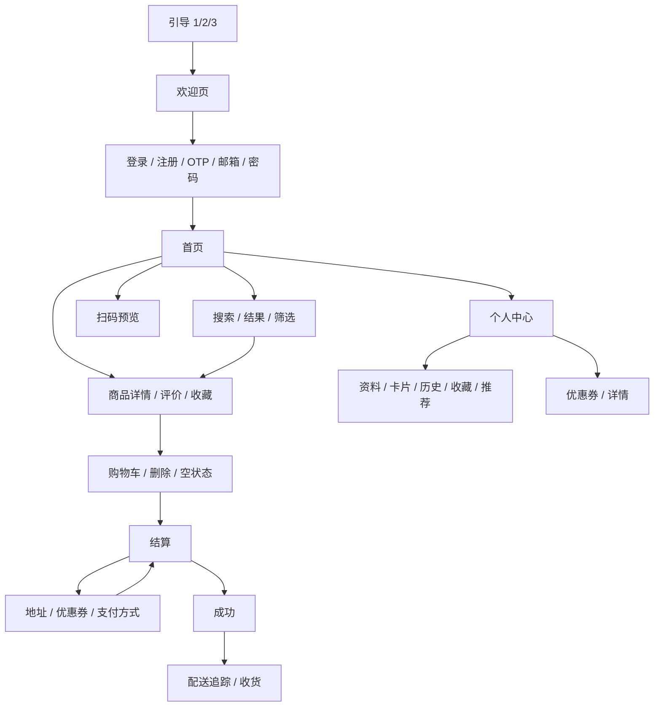

# 架构与维护说明

## 设计依据

Pixso 文件：Ecobi - Food & Delivery UI Kit。业务页面来自 `🍋 UI Design File`（1479:8324）；参考 Foundations 中的颜色、字体、商品图、分类图和状态插画。原始节点清单见 `design-inventory.json`。只读取和导出设计，未修改 Pixso 原文件。

## 模块职责

| 层/模块 | 职责 | 约束 |
| --- | --- | --- |
| main | Flutter 初始化、系统栏样式、读取本地状态 | 异步初始化完成后再展示应用 |
| app | 统一路由和屏幕预览入口 | `pages` 路由表是截图枚举的唯一来源 |
| core/theme | 颜色、字号、字体、按钮与输入框主题 | 主色 #20B653，文字 #141414，表面 #F8F8F8 |
| widgets/common | PageLayout、Panel、Segments、BottomTabs、Field、InfoRow 等 | 共享间距与交互样式，避免每页复制布局代码 |
| data | Product、演示数据、AppState、AppScope | 不依赖页面；统一计算金额和数量 |
| features | 以功能划分的页面与局部状态 | 焦点、输入值、当前 Tab 等只保留在页面中 |
| test / integration_test | 测试和截图 | 不进入正式应用流程 |

这份项目以 UI 还原和本地完整体验为目标，未引入服务层空壳、代码生成、多余的状态管理/路由依赖。业务依赖仅 `shared_preferences`；图片和字体随包分发，展示界面不依赖网络。

## 状态和存储

`AppScope` 继承 InheritedNotifier，将 `AppState` 向子树提供。购物车、用户资料等数据变化后通过 `notifyListeners()` 更新依赖界面。写入本地之前立即更新 UI；`save()` 将可恢复状态编码为 JSON 写入 `ecobi_state`。

| 数据 | 存储位置/生命周期 |
| --- | --- |
| 商品目录、原价、分类、品牌 | 不可变演示常量 |
| 购物车、收藏商品、收藏商店 | SharedPreferences 持久化 |
| 名称、邮箱、手机号、已完成引导/登录标志 | SharedPreferences 持久化 |
| 卡片末四位、演示订单 | SharedPreferences 持久化 |
| 密码、完整卡号、CVV | 页面输入期内存；不写入本地 |
| 当前商品、地址选择、支付方式、优惠券、筛选条件 | 当前会话共享状态 |
| 输入框内容、焦点、局部列表 Tab、临时新增地址、推荐邀请标记 | 当前页面状态 |

可恢复缓存格式异常时回退演示初始数据。演示缓存没有服务端同步，也不是生产身份验证凭据。

## 购物和订单约束

- `add`、`decrease`、`remove` 管理购物车；数量降到 1 后再减会出现删除确认。
- 单价来自 Product，金额显示统一经 `money()` 格式化。小计为单价乘数量之和，配送费为 0。
- 一次只能选择一张优惠券；Cafe Ara 为 15%，其他演示优惠为 20%。演示折扣作用于整个订单小计，不模拟商品适用资格或有效期校验。
- `placeOrder` 保存当前购物车快照、订单号和实付金额，然后清空购物车/优惠选择。
- `reorder` 将订单商品叠加到当前购物车；确认收货更新订单状态并保存。
- UI Kit 的 $256 固定合计、各页面不同的商品单价及不匹配数量没有作为业务规则使用。首页和详情使用统一目录价格。

## 页面与导航

所有页面由 `app.dart` 的 `pages` 注册。基础路径为 `/home`、`/product`、`/cart` 等。`INITIAL_ROUTE` 仅指定启动页面，方便验收单页；正常操作按导航按钮进入对应流程。

不同键盘和焦点状态用页面参数表达。页面长内容使用滚动容器，主要操作放在 SafeArea 底部；系统状态栏和手势区采用设备安全区。

## 精简与可扩展性

已将按钮、输入、商品卡片、金额行、分段切换、底部导航抽出复用；登录注册复用 AuthPage，结算选项复用 SelectionPage。空白、焦点和删除预览用参数表达，未为每张画板复制一份页面。界面使用 Flutter 原生布局和控件，图片只承载插画、地图和品牌装饰，没有使用整页原稿图片代替界面。

后续接真实服务时，建议在 data 下加入 Repository，将本地演示方法替换为异步请求；按订单/账户域拆分状态；生产价格使用整数最小货币单位；登录令牌使用安全存储；服务端校验库存、优惠、价格和支付结果。当前 UI 和路由可以复用。

## 真实服务尚未连接

短信、OAuth、支付、Apple Pay、地图/定位、相机识别、联系配送员及发送邀请均未接外部服务。相关入口保留演示行为或明确提示。城市、促销和无障碍筛选开关仅展示/保留状态，实际商品筛选支持名称、分类和价格范围。评价提交为本地反馈提示，不保存为正式评价列表。iOS 工程已生成，但 Windows 环境不能执行 iOS 构建和验收。
